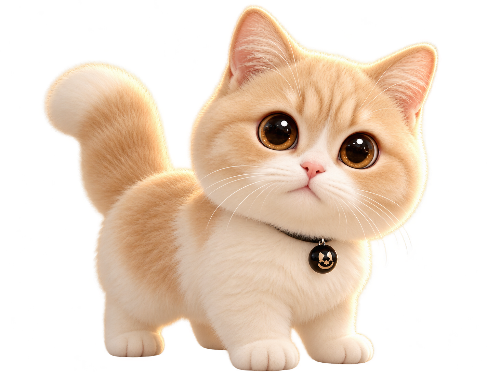

# 喵了么 · 桌面桌宠小助手

一只住在你桌面上的 3D 猫咪：提醒你喝水、开会、赶 DDL，陪你玩小游戏、帮你决定今天吃什么——把照片上传，还能把它变成你自己的专属 3D 桌宠。



## ✨ 功能特性

**🐱 桌宠本体**
- 三种内置形态：🐱 喵喵 / 🤖 小铁 / 🟢 咕叽，加上「自定义图片」形态
- **上传照片（可多选，最多 6 张）自动生成 3D 立体形象**（多参考图提升同一只猫的一致性）（站立/行走/打滚/舔毛/吃饭/睡觉 6 个姿势，透明底、Pixar 手办风；喝水/伸懒腰为内置形象动作）
- 多帧动态：每个动作 2–5 个关键帧序列播放（走路×4/打滚×5/舔毛×4/干饭×4/喝水×4/伸懒腰×3）
- **2D 骨骼动画（v0.6）**：内置猫使用「头/身体/尾巴」拆分部件；头部分带 warp（抬头/歪头不再整体旋转）、瞳孔随机微动（saccade）、尾巴临界阻尼弹簧惯性、光标注视、不规则呼吸
- **上传后自动生成专属骨骼部件**：身体/头/尾巴 + 闭眼帧 + 压耳帧（5 个），用于眨眼与耳朵抖动；部件缺失时自动回退序列帧，不会错配
- 拖动摆位置（记忆位置）、鼠标悬停呼出快捷菜单、桌面空白处点击穿透不挡工作

**💧 喂养玩法（把提醒变成养猫）**
- 到点猫咪撒娇讨水："我口渴了…主人也喝点水吧"，喂水后它真的低头喝水，亲密度+1
- 中午/晚上饭点讨猫粮，喂粮后播吃猫粮动画；没喂会隔几分钟再催一次
- 桌宠头顶脉动喂食按钮 + 悬停菜单 + 控制台 + 托盘，4 个入口都能喂

**⏰ 提醒系统**
- 喝水提醒（间隔可调）+ 久坐提醒
- 会议提醒（提前 5 分钟 + 到点）、工作 DDL（提前 1 天/1 小时/到点）
- 免打扰时段（跨午夜）、稍后提醒（贪睡 10/20/30 分钟）

**🍅 效率工具**
- 番茄钟（专注/休息自动循环，完成计入成就；应用重启后未到期的番茄会自动续跑，已过期的只提示、不虚增完成数）
- 🍱 吃饭转盘：午餐/晚餐独立菜单、转盘动画、自定义菜单
- 🎮 小游戏：石头剪刀布（战绩持久化）、猜数字、记忆翻牌、反应力测试

**🎨 养成与个性化**
- 亲密度/喝水/番茄成就系统 + 等级进度条
- 暗色模式、开机自启、全局快捷键 ⌘/Ctrl+⇧+P 呼出面板
- 状态栏小猫头托盘图标（含 2x 高清）

## 🚀 快速开始

环境要求：macOS（优先）或 Windows/Linux，Node.js ≥ 20，npm。

```bash
npm ci          # 按锁文件安装依赖
npm start       # 启动（launch.js 会自动清理 ELECTRON_RUN_AS_NODE，勿删）
npm test        # 运行单元测试（node:test，无额外依赖）
```

桌宠会出现在屏幕角落，控制台随启动打开。**关闭控制台窗口不会退出**，程序常驻在菜单栏托盘（小猫头图标）。

数据位置（本地 JSON，原子写入，损坏会自动备份为 `*.corrupt-<时间戳>` 后重建）：
- macOS：`~/Library/Application Support/miaoleme/zerobreak-store.json`
- Windows：`%APPDATA%/miaoleme/zerobreak-store.json`

从旧版「零度突破」升级时，应用会自动迁移旧数据目录。

## 📦 打包

```bash
npm run dist        # 构建当前平台安装包（dist/ 目录）
npm run pack        # 免安装目录版
```

- macOS：产出 `.dmg` + `.zip`（Apple Silicon）
- Windows：NSIS 安装包需要 Windows 环境构建，或推送到 GitHub 后由 Actions 流水线产出（工作流文件：`windows-build-workflow.yml`，移入 `.github/workflows/` 并推送即激活）

## 🔧 图像生成配置

**推荐：应用内配置。** 打开控制台 →「设置」→「图像生成服务」，选择服务商、填写接口地址与身份信息，点「保存配置」→「测试连接」。配置写入本机用户目录（文件权限 600），不会进入安装包、不会写入日志。

> 注意：未配置生成服务时，上传照片**只会显示原图**、不会生成 3D 形象——这是 Windows 分发版首次上手最常见的原因。

也可以手动创建配置文件（开发用）：复制 `generation.config.example.json` 为 `generation.config.json` 并填入凭据（`.gitignore` 已忽略）：

```json
{
  "provider": "comate",
  "comate": { "apiUrl": "<服务地址>", "loginName": "<身份头>" },
  "qianfan": { "apiUrl": "https://qianfan.baidubce.com/v2/images/generations", "apiKey": "<API Key>", "model": "ernie-image-turbo" }
}
```

行为说明：
- **未配置时不发起任何请求**，上传只使用原图
- 生成时把所选图片发送到配置的服务；配置可从用户数据目录或项目目录读取（前者优先）
- 站立帧优先生成，其余姿势并发 2；瞬时错误（429/5xx/超时）最多额外重试 2 次，认证/请求错误不重试
- 每次上传使用独立输入快照与任务 ID，旧任务的迟到结果不会覆盖新形象
- 结果状态：全部成功 / 部分成功（可重试失败项）/ 失败 / 已取消 / 未配置；面板可关闭重开后继续查看真实进度
- **美观闸门**：自动丢弃空/过小/碎裂/与站立帧比例失衡的帧（计为失败可重试），提示词同时约束「四条腿、一条尾巴、自然猫体态」，避免把明显做不出来的动作放上桌
- 千帆分支的图生图协议以实际服务为准，未联调前不代表兼容

## 📁 目录结构

```
├── main.js            # 主进程：窗口/托盘/调度/通知/喂养/图像生成
├── preload.js         # 安全的 IPC 桥
├── launch.js          # 开发启动器（规避 ELECTRON_RUN_AS_NODE 环境问题）
├── renderer/
│   ├── pet.html/css/js    # 桌宠窗口（多帧动画/交叉淡化/拖拽/穿透）
│   └── panel.html/css/js  # 控制台（6 个标签页）
├── assets/            # 桌宠帧/托盘图标（AI 生成，透明底）
├── build/             # 应用图标（icns/ico/png）
├── images/            # 原始生成图
└── tools/gen-frames.js # 补帧工具：为任意照片生成全套 3D 帧
```

## 🛠 技术栈

Electron 45（维护中版本）+ 原生 JS/CSS（无框架依赖），数据本地 JSON 存储（原子写入），安全基线：contextIsolation + sandbox + CSP + IPC 输入校验。

## 🧪 测试与验证

```bash
npm test        # 单元测试（node:test）：数据校验/损坏恢复、餐次去重、免打扰边界、会议/DDL 漏窗、
                # 番茄钟恢复策略、生成错误分类/图片校验、并发池、任务隔离/取消/截止/部分成功、
                # 坐标钳制、转盘落点一致性、帧质量闸门、视线平滑
```

验收记录（PASS / FAIL / BLOCKED / NOT_RUN）、实际验证方式与已知限制见 [docs/verification.md](docs/verification.md)。

## ❓ 常见问题

- **启动日志出现 `Unable to set login item: Operation not permitted`**：沙箱/终端环境不允许修改登录项，可忽略；在真实桌面中开机自启按设置生效。
- **上传照片后没有变成 3D**：确认 `generation.config.json` 已按示例配置；未配置时只使用原图，不会发起请求。面板会显示「未配置生成服务」。
- **生成部分失败**：面板显示「已生成 x/y，可重试失败项」，点「重试失败项」只补缺失帧。
- **桌宠找不到了**：点菜单栏小猫头打开控制台，或按 ⌘/Ctrl+⇧+P；位置会被记忆，多显示器变更后自动回到可见区域。
- **数据在哪**：见上文「快速开始」的数据位置；损坏的状态文件会被备份为 `*.corrupt-<时间戳>`。

## ⚠️ 说明与限制

- Windows 内测免安装包基于 Electron 33（受托管页 100MB 体积上限约束）；macOS 为 Electron 45。正式分发前 Windows 侧需升级并在真机冒烟。

- 打包产物未签名：首次打开若被拦截，右键 → 打开；正式分发需要签名/公证
- Windows 安装包（NSIS）需在 Windows 构建：仓库根目录 `windows-build-workflow.yml` 移入 `.github/workflows/` 后由 CI 产出
- 桌宠 3D 帧由图像生成模型制作，仅供本项目使用
- 本项目为独立作品，与任何模型/平台官方无关

## 📄 License

MIT
